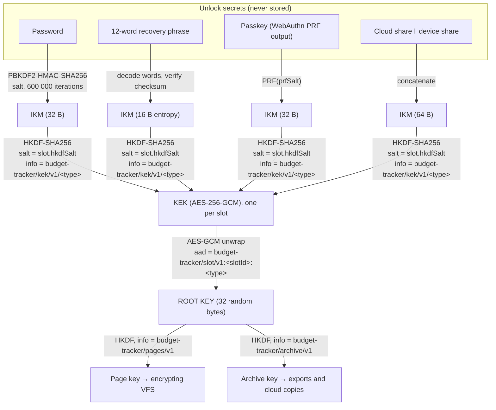

# Encryption and security design

This document describes how Budget Tracker protects the data it keeps in the browser, in exported backups and in cloud copies: what is encrypted, under which keys, how those keys are derived from the ways a user can unlock the app, and what an attacker gains or does not gain in each scenario.

The source of truth for the formats is the worker-side code in `public/`: `database-key-slots.js` (key hierarchy, key slots, header), `database-encryption.js` (archive envelope) and `database-encrypted-vfs.js` (page encryption). This document is kept in step with them.

- [1. Scope and threat model](#1-scope-and-threat-model)
- [2. Key hierarchy](#2-key-hierarchy)
- [3. Formats](#3-formats)
- [4. Flows](#4-flows)
- [5. Normalisation and KDF parameters](#5-normalisation-and-kdf-parameters)
- [6. Passkeys](#6-passkeys-webauthn-prf)
- [7. Cloud-account slot](#7-cloud-account-slot)
- [8. Reset and data-loss cases](#8-reset-and-data-loss-cases)
- [9. Test vectors](#9-test-vectors)
- [10. File map](#10-file-map)
- [Glossary](#glossary)

## 1. Scope and threat model

### What is protected

| Data | Where it lives | Protection |
|---|---|---|
| The live SQLite database | IndexedDB (`ptbudgetapp-v2-encrypted`), one record per 8 KiB page | Every page is AES-256-GCM encrypted by the encrypting VFS under the **page key** before it reaches IndexedDB. SQLite itself only ever sees plaintext pages in worker memory. |
| Exported backups (`budget-tracker-*.zip`) | The user's disk, email, drives… | AES-256-GCM under the **archive key**; the envelope carries what a new device needs to rebuild that key from the master secret (section 3.3). |
| Cloud copies (Google Drive / OneDrive sync) | The provider's storage | Exactly the same envelope as an export: the provider stores ciphertext plus a small plaintext header (format, timestamp, root-key id, the wrapped master slot). |
| The key material itself | IndexedDB (`ptbudgetapp-keys`, the *encryption header*) | The root key only ever exists wrapped (encrypted) under a key derived from one of the unlock secrets. Nothing in the header lets anyone recover it without such a secret. |

### What is not protected

- **A compromised browser or operating system.** While the database is unlocked, the root key and the derived keys are in the SharedWorker's memory and plaintext pages pass through SQLite. Malware with access to the browser process, or a malicious extension with access to the page, can read data or keys. The app only stops a wrong user, not a wrong machine.
- **Metadata.** File names, sizes and timestamps of backups, and the plaintext archive header, are visible to whoever can see the file. The header reveals that a backup exists, when it was saved, whether it is protected by a password or a recovery phrase, and the cost parameters of the KDF; it does not reveal anything about the data or the secret.
- **A forgotten master secret.** There is no recovery service. Losing the password or recovery phrase, with no other unlock method registered on a device that still has the data, means the data is gone (section 8).
- **Weak passwords.** A password slot is only as strong as the password: the KDF slows guessing down (600 000 PBKDF2 iterations), it does not make a short password strong. A generated recovery phrase has 128 bits of entropy and does not have this problem.

### Principles

1. **Every unlock method is cryptographically load-bearing.** Unlocking means recovering the root key by decrypting a key slot with a secret only the user has. The UI never "checks a credential and then releases a stored key": there is no stored key to release.
2. **Exactly one master slot.** A database is protected by a password *or* a 12-word recovery phrase, never neither. Passkeys and the cloud-account slot are convenience slots that can be removed at any time and can never be the only way in.
3. **The worker owns all key material.** The page (React) sends secrets to the SharedWorker and gets back "unlocked" or an error; it never sees the root key, the page key or the archive key. Secret buffers are transferred, not copied, and zeroed after use.
4. **Changing a secret never re-encrypts data.** Replacing the master or adding a slot re-wraps the 32-byte root key; the database and every backup stay as they are.

## 2. Key hierarchy



- The **root key** is 32 bytes from `crypto.getRandomValues`, generated once when the database is created. It is never derived from anything the user knows, so changing the master secret does not change it.
- A **key slot** stores the root key wrapped (AES-256-GCM encrypted) under a **KEK**. The KEK is derived with HKDF from the slot's input keying material (IKM) and a per-slot random salt, labelled with the slot type so password KEKs, passkey KEKs and so on are unrelated even from identical input.
- A failed unwrap (GCM authentication failure) *is* the wrong-secret signal. There is no separate verifier blob.
- The GCM additional data binds each wrapped key to its slot id and type, so a ciphertext cannot be moved from one slot record to another. The AAD is deliberately the same inside the encryption header and inside an archive, because the master slot record is copied verbatim into every export (section 3.3).
- The page key and archive key are derived from the root key with an empty HKDF salt (the root key is already uniformly random) and distinct labels, so they are independent and recomputable on any device that recovers the root key.

### Slot types

| Type | Role | IKM | What a device stores for it |
|---|---|---|---|
| `password` | master | `PBKDF2-HMAC-SHA256(NFKC(password), kdf.salt, kdf.iterations)`, 32 bytes | PBKDF2 salt and iteration count |
| `recovery` | master | The 16 entropy bytes decoded from the 12 BIP-0039 English words (checksum verified on the page) | Only the wordlist name and word count |
| `passkey` | convenience | The 32-byte output of the WebAuthn PRF extension for `kdf.prfSalt` (section 6) | Credential id, PRF salt, RP id, transports |
| `cloud` | convenience | A 32-byte share stored in the user's cloud app folder ‖ a 32-byte share stored only in this device's header (section 7) | Provider, share file name, device share |

## 3. Formats

All binary values are hex strings in JSON.

### 3.1 Encryption header (IndexedDB `ptbudgetapp-keys`, store `header`, key `default`)

Read before anything else, because the salt and wrapped key it holds are needed to derive the key that decrypts page 1 of the database.

```jsonc
{
  "id": "default",
  "format": "budget-tracker-page-encryption-header-v2",
  "createdAt": "2026-11-05T10:00:00.000Z",
  "updatedAt": "2026-11-05T10:00:00.000Z",
  "blockSize": 8192,                      // must match PRAGMA page_size
  "keyId": "<32 hex>",                    // public id of the root key (16 random bytes)
  "slots": [ /* SlotRecord[] */ ]
}
```

Invariants, checked on every write and on read before unlocking (`assertHeaderInvariants`): the format is v2, `keyId` is 16 bytes, exactly one slot is a master (`password` or `recovery`), slot ids are unique, every slot is well-formed and its `kdf.name` matches its type.

Format v1 (`budget-tracker-page-encryption-header-v1`, page key derived straight from the password, with a verifier blob) is recognised only to tell the user it cannot be opened (section 8).

### 3.2 Slot record

```jsonc
{
  "slotId": "<16 hex>",                   // 8 random bytes
  "type": "password" | "recovery" | "passkey" | "cloud",
  "label": "Password",
  "createdAt": "…", "lastUsedAt": "…" | null,
  "hkdfSalt": "<64 hex>",                 // 32 random bytes, HKDF salt for the KEK
  "wrap": { "alg": "A256GCM", "iv": "<24 hex>", "ciphertext": "<96 hex>" },   // 32-byte root key + 16-byte tag
  "kdf":  // by type
    { "name": "PBKDF2-HMAC-SHA256", "salt": "<64 hex>", "iterations": 600000, "normalization": "NFKC" }
  | { "name": "bip39-entropy", "wordlist": "english", "wordCount": 12 }
  | { "name": "webauthn-prf", "credentialId": "<base64url>", "prfSalt": "<64 hex>", "rpId": "…", "transports": [], "userHandle": "<base64url>" | null }
  | { "name": "cloud-split", "provider": "gdrive" | "onedrive", "shareFileName": "key-share-<keyId>-<slotId>.json", "deviceSecret": "<64 hex>" }
}
```

The only secret-bearing field is the cloud slot's `deviceSecret`, which is half of that slot's IKM and exists only in the device's own header (never in an archive). The page receives slot *summaries* (`summarizeSlot`) that drop `wrap`, `hkdfSalt`, the PBKDF2 salt and the device share.

### 3.3 Encrypted archive (exports and cloud copies)

```
[4 bytes  little-endian uint32: header length N]
[N bytes  UTF-8 JSON header, unencrypted]
[rest     AES-256-GCM ciphertext of the inner ZIP]
```

```jsonc
{
  "format": "budget-tracker-encrypted-v2",
  "lastSaveTimestamp": "…",               // readable without a key: cloud sync compares it
  "keyId": "<32 hex>",                    // which root key wrote this archive
  "iv": "<24 hex>",
  "algorithm": "AES-GCM", "keyLength": 256,
  "kdf": { "name": "HKDF-SHA256", "info": "budget-tracker/archive/v1" },
  "masterSlot": { /* verbatim copy of the writing database's master SlotRecord */ }
}
```

The inner ZIP is the plaintext VFS snapshot plus a status file (`src/lib/databaseArchive.ts`); the snapshot holds logical pages, so it is portable between devices that use different root keys.

Only the **master** slot travels in an archive. Passkey and cloud slots are device-local by design: a backup can never be opened with a passkey or a cloud account, only with the password or recovery phrase.

Format v1 (`budget-tracker-encrypted-v1`, PBKDF2 straight from the password) is recognised and rejected with `UNSUPPORTED_ARCHIVE_FORMAT`. `scripts/convert-archive-v1-to-v2.mjs` re-wraps such a file given its password (used for the e2e fixtures).

### 3.4 Key-share file (cloud slot, section 7)

```jsonc
{ "format": "budget-tracker-key-share-v1", "keyId": "…", "slotId": "…", "provider": "gdrive", "cloudSecret": "<64 hex>", "createdAt": "…" }
```

Stored in the provider's per-app hidden folder, one file per (database, device).

### 3.5 Error codes

The worker throws `EncryptionError` with a stable `code`; the page maps codes to translated messages (`setup:unlockErrors.*`, `settings:securityErrors.*`) and falls back to the English message.

`INVALID_SECRET`, `INVALID_RECOVERY_PHRASE` (page-side), `LEGACY_HEADER`, `HEADER_INVALID`, `NO_DATABASE`, `DATABASE_EXISTS`, `ALREADY_UNLOCKED`, `LOCKED`, `CANNOT_REMOVE_MASTER`, `SLOT_NOT_FOUND`, `INVALID_SLOT_TYPE`, `UNSUPPORTED_ARCHIVE_FORMAT`, `ARCHIVE_CORRUPT`, `ARCHIVE_KEY_MISMATCH`, `PASSKEY_PRF_UNSUPPORTED`, `PASSKEY_CANCELLED`, `CLOUD_SHARE_MISSING`.

## 4. Flows

Worker messages are in `public/database-worker.js` (`handleMessage`); the page-side transport is `src/lib/databaseWorkerService.ts`.

### Create (`create_new_database`)

```mermaid
sequenceDiagram
    participant UI as Setup screen
    participant W as SharedWorker
    UI->>W: create_new_database { master: {type, secret} }
    W->>W: rootKey = random(32); keyId = random(16)
    W->>W: masterSlot = createSlot(master, rootKey)
    W->>W: write header v2 { keyId, slots: [masterSlot] }
    W->>W: pageKey, archiveKey = HKDF(rootKey); vfs.setKey(pageKey)
    W-->>UI: opened
```

With a recovery phrase the page generates the 12 words, makes the user confirm three of them, decodes them and sends only the 16 entropy bytes.

### Unlock (`unlock_database`)

```mermaid
sequenceDiagram
    participant UI as Lock screen
    participant W as SharedWorker
    UI->>W: get_unlock_methods
    W-->>UI: { methods: [slot summaries], legacyHeader }
    UI->>W: unlock_database { method: {type, slotId?, secret} }
    W->>W: slot = master slot, or findSlot(slotId)
    W->>W: rootKey = openSlot(slot, secret)   (INVALID_SECRET on GCM failure)
    W->>W: install rootKey → pageKey, archiveKey; vfs.setKey
    W-->>UI: opened (or error code)
```

`get_unlock_methods` works while locked, so the lock screen knows whether to show the password form, the recovery-phrase form, or (later phases) passkey / cloud buttons. The worker refuses a v1 header with `LEGACY_HEADER`.

### Lock

`lock_database` closes the SQLite connection, zeroes the root key and drops the derived keys; the VFS refuses reads and writes until the next unlock. `terminate_worker` (Reset App) does the same and deletes both IndexedDB databases.

### Replace the master (`replace_master`)

Verifies the current secret against the master slot, creates a new master slot (password or recovery phrase) wrapping the *same* root key, and writes the header with the old master slot removed and convenience slots untouched. No page and no backup is re-encrypted. When the database is cloud-linked, the page marks it dirty and syncs at once, so the cloud copy's embedded master slot is the new one.

### Add / remove / rename a convenience slot (`add_slot`, `remove_slot`, `rename_slot`)

Only while unlocked (the root key must be in memory to wrap it). The master slot cannot be removed (`CANNOT_REMOVE_MASTER`); it can only be replaced.

### Export (`encrypt_archive`)

The inner ZIP is encrypted under the in-memory archive key; the header gets the `keyId` and a copy of the master slot.

### Restore on a new device (`decrypt_archive` with `master`, then `create_new_database` with `restoreFrom`)

```mermaid
sequenceDiagram
    participant UI as Setup screen
    participant W as SharedWorker
    UI->>UI: read archive header → masterSlot.type decides the form
    UI->>W: decrypt_archive { master }   (verification only)
    W->>W: rootKey = openSlot(meta.masterSlot, master); decrypt with HKDF(rootKey)
    W-->>UI: ok
    UI->>W: create_new_database { master, restoreFrom: { keyId, masterSlot } }
    W->>W: rootKey = openSlot(masterSlot, master); header = { keyId, slots: [masterSlot] }
    UI->>W: decrypt_archive (no master: same keyId → in-memory archive key)
    UI->>W: import_database_snapshot
```

The restored database **keeps the archive's root key and master slot**, so the backup and every device restored from it share one master secret, and later backups from any of them are interchangeable.

### Cloud pull adopting a master changed elsewhere

A pulled archive with the same `keyId` decrypts with the in-memory archive key, no secret needed. If its `masterSlot` differs from the local one (the master was changed on another device), `adoptArchiveMasterSlot` replaces the local master slot so this device asks for the new secret from now on. Convenience slots are unaffected, because they wrap the same root key. An archive with a different `keyId` is `ARCHIVE_KEY_MISMATCH`: it belongs to another database and needs its own master secret.

### Legacy (v1) header

A header from before key slots cannot be opened: the only way forward is Reset App (which deletes the local database) and a fresh setup or a restore from a current-version backup. The app says so instead of showing a password prompt that could never succeed.

### Reset App

From the lock screen (debug builds), Reset App requires the master secret (`verify_master`) before anything is deleted; from an unlocked session it does not, the user already authenticated.

## 5. Normalisation and KDF parameters

| Secret | Normalisation | KDF | Parameters |
|---|---|---|---|
| Password | Unicode NFKC, so composed/decomposed accents and full-width characters typed on different platforms derive the same key | PBKDF2-HMAC-SHA256 → 32 bytes, then HKDF | salt: 32 random bytes per slot; iterations: 600 000 (stored per slot in `kdf.iterations`) |
| Recovery phrase | Lowercase, NFKD, split on any whitespace; checksum verified before the worker is called | none needed (128 random bits) — HKDF only | — |
| Passkey PRF output | — | HKDF only | per-slot `prfSalt` (32 random bytes) |
| Cloud share | — | HKDF only | per-slot device share (32 random bytes) |

All HKDF steps use SHA-256, the slot's `hkdfSalt` and the `info` label `budget-tracker/kek/v1/<type>`; AES-GCM uses a fresh 12-byte IV for every wrap and every archive.

**Upgrading the KDF.** `kdf` is self-describing per slot, so a future version can create password slots with `{ "name": "argon2id", … }` (WebCrypto has no Argon2; it would need a WASM implementation in the worker) without a header format bump: old slots keep working with their recorded parameters, and a "replace master" writes a new-style slot.

## 6. Passkeys (WebAuthn PRF)

*Planned (Phase 2); the key-slot format already defines the `passkey` type.*

A plain WebAuthn assertion cannot protect data in a client-only app: checking a signature in JavaScript and then releasing a stored key would be a UI gate, not encryption, and signatures cannot be turned into stable keys. The **PRF extension** (CTAP2 `hmac-secret`) can: for a registered credential and a salt the authenticator returns `HMAC(credentialSecret, salt)`, 32 bytes that are the same every time and never leave the authenticator without user verification. That output is the passkey slot's IKM.

- Registration: `navigator.credentials.create` with `residentKey: 'required'`, `userVerification: 'required'`, `extensions.prf.eval.first = prfSalt`. If the platform reports `prf.enabled !== true` the passkey cannot be used (`PASSKEY_PRF_UNSUPPORTED`); if it reports enabled but returns no output at creation, an immediate `get()` supplies it.
- Unlock: `navigator.credentials.get` with `allowCredentials` from the slot summaries and `prf.evalByCredential`; the page transfers the 32-byte output to the worker, which derives the KEK and unwraps the root key.
- **User verification is always required**: `hmac-secret` returns different outputs with and without UV, so mixing them would make unlock fail silently.
- Passkeys are bound to the origin (RP id `localhost` in development, the deployed host in production); moving between origins means registering again. Backups never contain passkey slots, so a lost authenticator is never a lost database as long as the master secret is known.
- Platform support (PRF): Chrome with security keys, Google Password Manager and hybrid (phone) passkeys; Safari 18+ with iCloud Keychain; recent Firefox. The UI hides the option where `PublicKeyCredential` or PRF is unavailable.
- Testing: Chromium's DevTools protocol virtual authenticator (`WebAuthn.addVirtualAuthenticator` with `hasPrf: true`) lets Playwright cover registration and unlock without hardware.

## 7. Cloud-account slot

*Planned (Phase 3); the key-slot format already defines the `cloud` type.*

OAuth and OpenID Connect cannot produce an encryption key: tokens rotate and identity claims are public identifiers. What a signed-in account *can* provide is a place to keep a random key share: Google Drive's hidden `appDataFolder` (scope `drive.appdata`, requested only when the user opts in) or the OneDrive app folder (`/me/drive/special/approot`, covered by `Files.ReadWrite`; visible to the user under *Apps*).

Because the cloud copy of the database lives in the same account, the share alone must not be enough — otherwise encryption would collapse to "whoever controls the account". The slot therefore **splits the secret**: `IKM = S_cloud ‖ S_device`, where `S_cloud` is the share in the app folder and `S_device` is a share that exists only in this device's encryption header.

| Attacker has | Can they decrypt? |
|---|---|
| The cloud account only (phishing, provider request) | No: ciphertext and `S_cloud`, but not `S_device`. |
| The device's storage only (stolen disk image) | No: pages, header and `S_device`, but not `S_cloud`, and the master slot still needs the secret. |
| The cloud account **and** the device | Yes — the same as a user who signs in on that device. |

The slot means "unlock with my Google / Microsoft account *on this device*"; it needs network access and is never embedded in archives. It is weaker than a passkey (the share is fetched into JavaScript on every unlock) and is offered as an opt-in extra, never as the only slot.

## 8. Reset and data-loss cases

| Situation | Outcome |
|---|---|
| Master secret forgotten, a passkey or cloud slot registered on this device | The database can still be opened here; Settings → Security lets the user set a new master (replace requires the *current* master — a lost master means export a backup, Reset App, and restore it… which needs the master). **Practical rule: use the convenience unlock to export a backup *only if* a current-version restore is possible — it is not without the master.** Treat a lost master as lost data and move the data out of the app through plain exports (CSV) while still unlocked. |
| Master secret forgotten, no other slot | The data is unrecoverable by design. Reset App starts over. |
| Lost authenticator / cloud access | Unlock with the master; remove the dead slot in Settings. |
| Header deleted (cleared site data) while the worker still holds keys | The worker notices the orphaned key, drops it and the app returns to setup. |
| Header from a version before key slots (v1) | `LEGACY_HEADER`: reset required; only current-version backups restore. |
| Backup from another database | `ARCHIVE_KEY_MISMATCH`: the UI asks for *that* backup's master secret. |
| Removing a slot | Stops future unlocks with it. Someone who already copied the header and pages, and still has that slot's secret, could still open that copy — a true revocation needs a new root key, i.e. export, reset, restore (planned "rotate root key" action). |

## 9. Test vectors

Recorded by `src/lib/databaseKeySlots.test.ts` and `src/lib/recoveryPhrase/bip39.test.ts`.

**Root key subkeys.** For root key `000102…1e1f` (bytes 0x00–0x1f) the AES-GCM encryption of `01 02 03` with an all-zero 12-byte IV is:

| Subkey | info | ciphertext ‖ tag (hex) |
|---|---|---|
| page key | `budget-tracker/pages/v1` | `0437465a125a42a93b960a79763e376fa80de1` |
| archive key | `budget-tracker/archive/v1` | `ff0dd1f7f70a73653e727df34453c60bfedbc5` |

**Recovery phrase** (BIP-0039 English, 128-bit entropy):

| Entropy | Words |
|---|---|
| `00000000000000000000000000000000` | abandon ×11 about |
| `7f7f7f7f7f7f7f7f7f7f7f7f7f7f7f7f` | legal winner thank year wave sausage worth useful legal winner thank yellow |
| `80808080808080808080808080808080` | letter advice cage absurd amount doctor acoustic avoid letter advice cage above |
| `ffffffffffffffffffffffffffffffff` | zoo ×11 wrong |

The vendored wordlist's SHA-256 is `2f5eed53a4727b4bf8880d8f3f199efc90e58503646d9ff8eff3a2ed3b24dbda` (upstream `bip-0039/english.txt`).

## 10. File map

| File | Role |
|---|---|
| `public/database-key-slots.js` | Root key, slot records, KEK derivation, wrap/unwrap, header invariants, master adoption |
| `public/database-encryption.js` | Archive envelope v2, `EncryptionError`, byte helpers |
| `public/database-encrypted-vfs.js` | Per-page AES-GCM over the IndexedDB VFS (unchanged by the key-slot design) |
| `public/database-worker.js` | Worker messages: create / unlock / lock / replace master / slots / archive |
| `src/lib/encryptionTypes.ts` | Page-side contracts (`MasterSecret`, `UnlockMethod`, `SlotSummary`, error codes) |
| `src/lib/databaseEncryption.ts` | Page-side archive header reader (parity-tested against the worker module) |
| `src/lib/recoveryPhrase/` | BIP-0039 wordlist and 12-word encode / decode / validate |
| `src/lib/passkeyUnlock.ts` *(Phase 2)* | WebAuthn PRF registration and assertion |
| `src/lib/cloudKeyShare.ts` *(Phase 3)* | Cloud app-folder key share |
| `src/components/setup/` | `PasswordSetup`, `RecoveryPhraseSetup`, `RecoveryPhraseField`, `UnlockScreen`, `LegacyDatabaseNotice` |
| `src/components/settings/` | `SecurityKeySlotsSection`, `SwitchMasterDialog`, `ChangePasswordSection` |
| `scripts/convert-archive-v1-to-v2.mjs` | Re-wraps a v1 archive as v2 (fixtures) |

## Glossary

| Term | Meaning here |
|---|---|
| Root key | The random 256-bit key at the top of the hierarchy; wrapped by every slot |
| DEK | Data-encryption key: the page key and the archive key, both HKDF outputs of the root key |
| KEK | Key-encryption key: one per slot, derived from that slot's secret; it only ever encrypts the root key |
| Key slot | One unlock method: its public parameters plus its wrapped copy of the root key |
| Master slot | The password or recovery-phrase slot; exactly one per database; the only slot copied into backups |
| Convenience slot | A passkey or cloud-account slot: device-local, removable, never the only slot |
| IKM | Input keying material: the raw secret bytes HKDF turns into a KEK |
| HKDF | HMAC-based key derivation (RFC 5869): fast, for input that is already strong; the `info` label keeps derived keys independent |
| PBKDF2 | Slow, iterated key derivation for passwords; makes guessing expensive |
| AAD | Additional authenticated data in AES-GCM: authenticated but not encrypted; binds a wrapped key to its slot |
| PRF | Pseudo-random function; for passkeys, the WebAuthn PRF extension (`hmac-secret`) |
| BIP-0039 | The wordlist and checksum scheme borrowed for the recovery phrase; nothing else from it applies |
