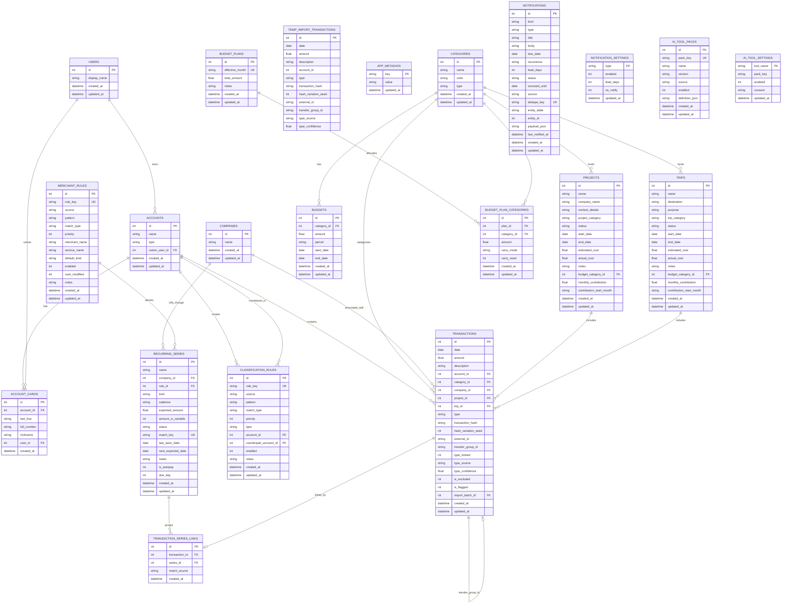

# Updated Database ER Diagram

Based on the current database schema (source of truth: `public/database-schema.js`), including users, accounts, account cards, trips, merchant rules, and recurring-subscription tracking:

## Key Features:

1. **Users Table**: Central user management with display names
2. **Accounts + Account Cards**: Accounts are owned via `owner_user_id`; card last-four digits live on `account_cards` and drive CSV import account matching. `account_cards.last_four` is unique per account (not globally), so different accounts may share a last-four; an optional `full_number` disambiguates them (used only for matching — never displayed, since the UI always shows just the last four digits) via `idx_account_cards_full_number`
3. **Trips Table**: Full trip management with categories, status, dates, and costs
4. **Transaction Labeling**: Transactions can be associated with both projects and trips
5. **CSV Import Staging**: `temp_import_transactions` stages imports for duplicate analysis before `transactions` receives them
6. **Merchant Rules**: Community-seeded + user-defined description patterns that map raw bank charge descriptions to merchants (`companies`), optional services, and a default kind (subscription / bill / purchase). Community reseeds respect `user_modified`
7. **Recurring Series**: Detected subscriptions and recurring bills with cadence, expected amount, status lifecycle (candidate → active / inactive / ignored), and idempotent rescans via unique `match_key`
8. **Transaction–Series Links**: Join table connecting transactions to their recurring series (avoids altering the transactions table)
9. **App Metadata**: Key/value store for versioned assets such as the community merchant-rules seed version. Feature code namespaces its keys (`notifications.*`, `ai.*`, `logging.*`); `ai.provider.config` holds the AI provider profiles (including API keys, which is why they live in the encrypted database)
10. **Budget Carry-over** (v3): `budget_plan_categories.carry_mode` rolls unused (`surplus`), overspent (`deficit`) or both into the next month; `carry_reset = 1` zeroes the carried balance from that plan's `effective_month`
11. **Savings Funds** (v3): a project or trip may link to a budget category (`budget_category_id`) with a `monthly_contribution` accruing from `contribution_start_month`; the fund balance is contributions minus linked spend
12. **Notifications** (v3): user reminders (birthday / anniversary / seasonal / custom; once, monthly, yearly) and system alerts (overdue non-autopay payments, budget overspend). Alerts upsert on `dedupe_key` so rescans are idempotent; `notification_settings` holds per-type lead-time defaults. `recurring_series.is_autopay` / `due_day` drive payment reminders
13. **AI Tool Registry** (v3): `ai_tool_packs` stores user-imported declarative tool packs; `ai_tool_settings` stores the per-tool enable flag and consent policy (`ask` / `always` / `deny`)
14. **Transaction Classification** (v4): `transactions.type` (`income` / `expense` / `refund` / `transfer`) is the only thing analytics look at; `type_source` records how it was decided (`sign` default, `rule`, `pair`, `inferred`, `manual`) and `type_confidence` the detector's confidence. The two legs of a transfer share `transfer_group_id`. `classification_rules` holds the household's description patterns ("PYMT BY FUNDS TRANSFER" → transfer), optionally scoped to one account and naming the transfer's counterpart account. `type_locked = 1` / `type_source = 'manual'` marks a user decision that automatic classification never overrides. The classifier (`src/lib/transactionClassifier.ts`) runs on the staged rows of a CSV import, on demand from the Transactions page, and once per database on open

## Relationships:

- **One-to-Many**: Users → Accounts → Transactions
- **Optional References**: Transactions can reference Projects, Trips, Categories, and Companies
- **Flexible Labeling**: Transactions can be labeled with either a Project OR a Trip (or neither)
- **Merchant Mapping**: `merchant_rules.merchant_name` is resolved to a `companies` row at match time (not a hard FK, so rules can seed before companies exist)
- **Subscriptions**: A transaction belongs to at most one recurring series (`transaction_series_links.transaction_id` is UNIQUE)
- **Transfers**: exactly two rows (in different accounts, opposite directions) share a `transfer_group_id`; deleting or re-typing one leg clears the group on the other

## Schema Versioning:

Schema changes are delivered by a `PRAGMA user_version`-gated migration runner in `public/database-worker.js` (`runMigrations()`), driven by the `MIGRATIONS` export in `public/database-schema.js`. Migration statements must be idempotent (`CREATE TABLE IF NOT EXISTS`) because fresh databases already receive all tables from `createTables()`, which creates every entry of `CREATE_TABLES` in declaration order.

| Version | Contents |
|---|---|
| 1 | merchant_rules, recurring_series, transaction_series_links, app_metadata |
| 2 | budget tables and income_sources (back-filled), import_batches, account_balance_snapshots, accounts/transactions rebuilds, SHA-256 rehash |
| 3 | notifications, notification_settings, ai_tool_packs, ai_tool_settings; `recurring_series.is_autopay` / `due_day`; `budget_plan_categories.carry_mode` / `carry_reset`; `projects` and `trips` fund columns (`budget_category_id`, `monthly_contribution`, `contribution_start_month`). Every added column is nullable or defaulted, so sample-data fixtures need no regeneration |
| 4 | classification_rules; `transactions.type_source` / `type_confidence` (defaulted; rows with `type_locked = 1` are backfilled to `manual`); `temp_import_transactions` recreated with `transfer_group_id` / `type_source` / `type_confidence`. On the first open after the upgrade the app runs one classification scan so pre-existing card payments and merchant credits get typed |
